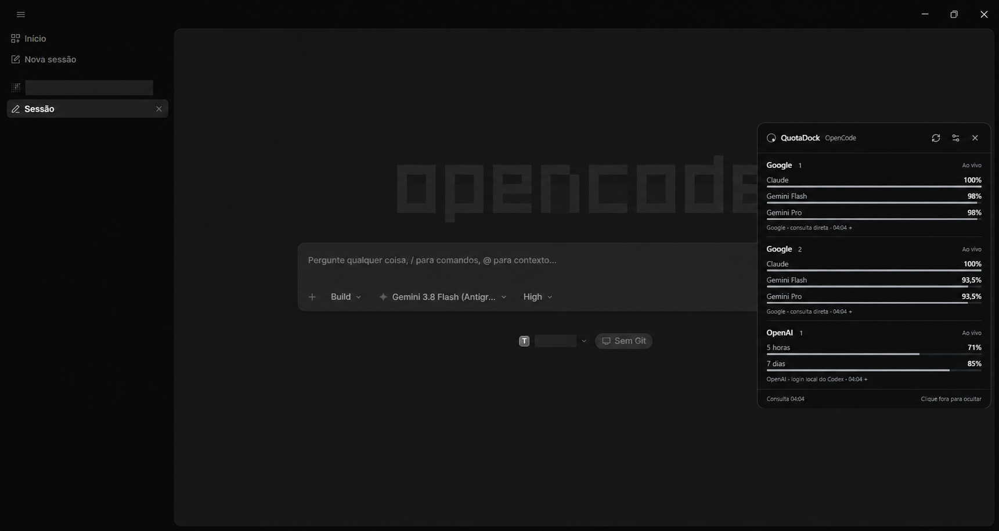
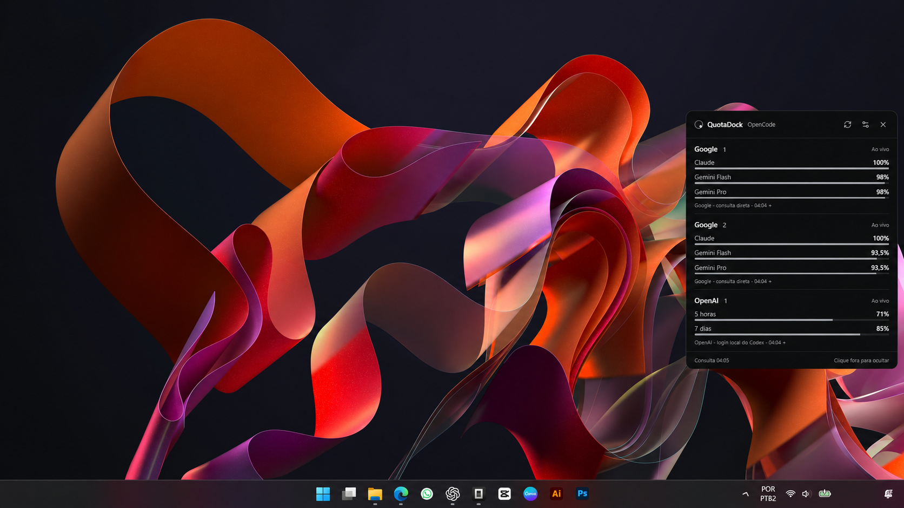

# QuotaDock para OpenCode

**As quotas das contas que você usa no OpenCode, em um painel discreto na bandeja do Windows.**

[](https://github.com/entaocadu/quota-dock/releases/latest)
[](https://github.com/entaocadu/quota-dock/actions/workflows/ci.yml)
[](LICENSE)


[**Baixar a versão atual**](https://github.com/entaocadu/quota-dock/releases/latest) · [Primeiros passos](docs/INSTALLATION.md) · [Documentação](docs/README.md) · [Reportar problema](https://github.com/entaocadu/quota-dock/issues/new/choose)



O QuotaDock é um aplicativo complementar e independente para quem usa o [OpenCode](https://opencode.ai/). Ele reúne as leituras de quota das contas Google/Antigravity e OpenAI usadas no seu fluxo de programação, sem precisar abrir uma página para consultar cada conta.

O OpenCode continua sendo o agente de programação. O QuotaDock cuida do acompanhamento das quotas: consulta os provedores, identifica as contas e apresenta percentuais restantes, horários de renovação e a origem de cada leitura.

## O que ele faz

- **Google/Antigravity:** detecta as contas do plugin do OpenCode e consulta o saldo por modelo. O resumo agrupa Claude, Gemini Flash e Gemini Pro.
- **OpenAI:** mostra as janelas de limite Codex da conta, usando um login compatível salvo ou uma conexão própria pelo navegador. Não precisa executar nem manter o Codex aberto.
- **Múltiplas contas:** adapta a altura ao conteúdo; listas grandes usam rolagem. As consultas têm concorrência limitada, sem uma quantidade fixa de cartões.
- **Atualização:** consulta ao abrir, permite atualização manual e continua consultando em segundo plano. O intervalo padrão é um minuto; os ajustes oferecem 1, 2, 5 ou 10 minutos.
- **Painel discreto:** visual preto carbono, entrada suave pela direita, arrasto pelo título, suporte à redução de movimento e recolhimento para a bandeja ou barra de tarefas.
- **Fixação:** pode permanecer acima de outros aplicativos e continuar aberto quando você clicar fora.
- **Dados locais protegidos:** credenciais ficam no backend; sessões próprias OpenAI usam Windows DPAPI. Não há servidor de telemetria do QuotaDock.

> **O que a quota OpenAI significa:** a fonte retorna os limites Codex da conta. Ela não informa um teto separado do novo compartilhamento de assinatura com o OpenCode. O painel identifica essa origem; não apresenta esse teto separado como se tivesse sido medido. [Entenda as fontes](docs/PROVIDERS.md).

## Comece por aqui

1. Tenha o OpenCode configurado com as contas que deseja acompanhar. Para Google, use o [plugin Antigravity compatível](https://github.com/pieliesdie/opencode-antigravity-auth).
2. Baixe `QuotaDock-0.3.0-Setup.exe` na [release atual](https://github.com/entaocadu/quota-dock/releases/latest). O aplicativo requer Windows 10/11 x64 e Microsoft WebView2.
3. Abra o QuotaDock pelo ícone da bandeja de apps do Windows. Ele inicia recolhido.
4. Para uma sessão OpenAI com renovação independente, acesse **Ajustes → Adicionar conta OpenAI** e conecte a mesma conta usada no OpenCode. Repita para outras contas.

Também há um pacote portátil. Mantenha `WebView2Loader.dll` ao lado de `QuotaDock.exe`. Consulte [instalação, atualização e verificação SHA-256](docs/INSTALLATION.md).

## Como usar

| Ação | Resultado |
|---|---|
| Clique no ícone da bandeja | Abre ou recolhe o painel |
| Arraste o título | Move a janela; a próxima abertura retorna à borda direita |
| Clique fora | Recolhe, quando a fixação está desativada |
| Esc ou botão X | Recolhe mesmo com a janela fixada |
| Botão Atualizar | Força uma nova consulta |
| Clique na fonte abaixo da conta | Abre detalhes, modelos e horários informados |
| Menu da bandeja → Sair | Encerra o aplicativo |

Em **Ajustes**, escolha iniciar com o Windows, fixar acima de outros apps, mostrar na barra de tarefas e definir o intervalo de atualização. [Guia de configuração](docs/CONFIGURATION.md).

<details>
<summary>Ver o painel na área de trabalho do Windows</summary>



</details>

As imagens foram feitas a partir dos prints fornecidos pelo autor, com edição visual para remover identificações de contas e projetos. Os saldos ilustram aquele momento; não são limites fixos nem uma promessa de quota. [Sobre as imagens](docs/assets/README.md).

## Documentação

| Para quem usa | Para quem desenvolve |
|---|---|
| [Instalação e atualização](docs/INSTALLATION.md) | [Compilar e testar no Windows](docs/DEVELOPMENT.md) |
| [Contas e configurações](docs/CONFIGURATION.md) | [Arquitetura e fluxo de dados](docs/ARCHITECTURE.md) |
| [Fontes e interpretação das quotas](docs/PROVIDERS.md) | [Testes e validação](docs/VALIDATION.md) |
| [Solução de problemas e FAQ](docs/TROUBLESHOOTING.md) | [Preparar uma release](docs/RELEASING.md) |
| [Privacidade e armazenamento](docs/PRIVACY.md) | [Como contribuir](CONTRIBUTING.md) |

Veja também o [histórico de mudanças](CHANGELOG.md), a [política de segurança](SECURITY.md) e os [avisos de terceiros](LICENSE_NOTICES.md).

## Estrutura do repositório

```text
quota-dock/
├── README.md              # Apresentação e primeiros passos
├── docs/                  # Guias e imagens sanitizadas
├── .github/               # CI, formulários de issues e modelo de PR
├── CONTRIBUTING.md        # Fluxo de contribuição
├── SECURITY.md            # Reportar vulnerabilidades
├── CHANGELOG.md           # Histórico das versões
├── LICENSE                # MIT
└── quota-dock/            # Aplicativo Tauri + React + Rust
    ├── src/               # Interface e testes Vitest
    ├── src-tauri/         # Backend, integrações e testes Rust
    ├── tests/fixtures/    # Exemplos fictícios para testes
    └── scripts/           # Ferramentas de verificação do aplicativo
```

## Desenvolvimento rápido

Use **Node.js 24**, Rust e uma toolchain Windows compatível. Os pré-requisitos completos e os comandos de desenvolvimento estão no [guia](docs/DEVELOPMENT.md).

```powershell
cd quota-dock
npm ci
npm test
npm run build
npm run test:rust
npm run tauri build -- --bundles nsis
```

## Licença e independência

Código do QuotaDock sob [MIT](LICENSE). O projeto é mantido por [entaocadu](https://github.com/entaocadu) e não possui afiliação oficial com OpenCode, OpenAI ou Google. Marcas, interfaces e componentes de terceiros seguem seus próprios termos; veja [LICENSE_NOTICES](LICENSE_NOTICES.md).
