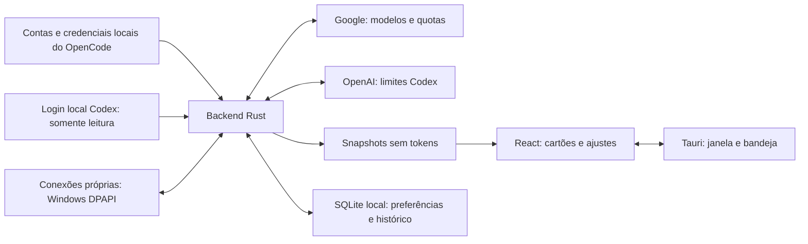

# Arquitetura

O QuotaDock é um aplicativo nativo de bandeja para Windows, complementar ao OpenCode. React apresenta os dados; Rust concentra credenciais, consultas de rede, armazenamento e comportamento nativo. Tauri faz a comunicação entre as duas partes.

## Consulta e normalização

`QuotaService`, em `src-tauri/src/lib.rs`, serializa ciclos de atualização e guarda um cache em memória. Google e OpenAI são consultados no mesmo ciclo. Cada provedor limita a concorrência a seis consultas de contas, preservando a ordem dos resultados.

`providers/live.rs` descobre as fontes e converte respostas para `QuotaSnapshot`. `providers/native_auth.rs` controla as sessões OpenAI próprias, identidade, PKCE, callback local, cifragem DPAPI e renovação. Fontes reconhecidas da mesma conta são reunidas; fontes compatíveis saudáveis podem substituir uma preferida expirada.

As janelas OpenAI preservam durações e horários informados. Modelos Google mantêm os nomes da resposta e são filtrados pelas famílias suportadas. O resumo mínimo por família é feito em `QuotaCard.tsx`. Campos ausentes continuam ausentes.

## Interface e transições

`App.tsx` recebe snapshots e eventos, mantém a tela de ajustes e observa a altura do conteúdo. `flyoutMotion.ts` anima o painel via Web Animations e descarta eventos antigos por token de transição.

O backend prepara geometria e posição, sinaliza abertura e aguarda a interface estar pronta antes de mostrar a janela. Na saída, a interface anima e conclui o recolhimento. Um fallback nativo na thread de UI valida o token antes de ocultar ou minimizar.

`tray/mod.rs` também administra fixação, visibilidade na barra, arrasto e múltiplos monitores. A perda de foco é conferida após a transferência entre WebView e janela nativa, evitando que o início do arrasto recolha a janela. A preferência de reduzir movimento remove a animação da interface.

## Persistência e fronteiras

Os comandos Tauri entregam DTOs sanitizados, não tokens. Preferências e até 2000 snapshots ficam no SQLite local. As sessões próprias ficam em arquivos separados por identidade derivada, protegidos por DPAPI. Logins OpenCode e Codex são abertos somente para leitura.

Campos e componentes legados de histórico, diagnóstico ou tokens locais permanecem no código. Eles não compõem uma promessa de telas acessíveis na interface compacta 0.3. A lista de comandos registrada e `App.tsx` definem o fluxo exposto.

## Contratos e testes

Os contratos Rust e TypeScript usam nomes JSON em camelCase. A versão de contrato está nos DTOs. Testes Rust cobrem parsing, identidade, normalização, persistência, proteção Windows e políticas de janela; testes Vitest cobrem cartões e transições. Fixtures usam dados fictícios.

[Fontes](PROVIDERS.md) · [Privacidade](PRIVACY.md) · [Validação](VALIDATION.md)
